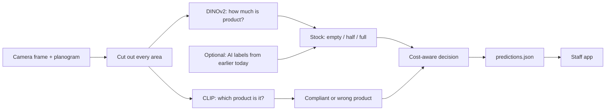

# Fresh.

**See every shelf. Fix what matters first.**

*Shelf intelligence for fresh produce, from the cameras your store already has.*


**Ceiling cameras + a planogram in, a staff to-do list out: for every shelf area of every picture, Fresh
says whether the right product is there and whether it is empty, half or full. It runs on one CPU core for about
$0.00005 per image and needs no labels to run.**

JunctionX Lisbon 2026, Sensei challenge "Fresh eyes on fresh produce" ([brief](docs/brief.txt)). Team
**QuantumLotus**.

| | |
|---|---|
| **Score on late frames** (held out, max 2 points per area) | **1.41 to 1.48** (last two frames / last frame of every camera) |
| **Score on unseen cameras** | **1.23** |
| **Label-free score** (no labels at all) | 1.18 / 0.99 / 0.88 (unseen cameras / last two / last frame) |
| **Cost per image** | **3.8 CPU-seconds** on one core, **~$0.00005** (about 5 cents per 1,000 images) |
| **Labels needed to run** | **none** (labels from the same day make it better) |
| Baseline "always compliant and full" | 0.76 / 0.46 / 0.18 |

All scores are measured against an **AI-made answer key**, not Sensei's hidden annotations
([how it was made](docs/LABELLING_GUIDE.md)). Evidence for every number: [`results/`](results/README.md).

## In 30 seconds

Each camera always sees the same shelves, and the planogram says where each product should be. For every
planogram area we cut out the picture, measure how much of it is product rather than empty crate (DINOv2
features, clustered without labels), and ask CLIP which fruit or vegetable it shows. A decision rule built from
the challenge's own scoring turns those probabilities into the safest answer: it leans towards "less stock",
because over-reporting stock costs more than under-reporting it. The submission adds a small calibration layer
fitted on AI labels from earlier the same day. Everything runs locally on free open models; no paid API and no
GPU. The output is the `predictions.json` the challenge asks for, plus a static staff app that turns it into a
prioritised to-do list.

## The brief asked, we built, the evidence

| The brief asks | What we built | Evidence |
|---|---|---|
| Task 1: find the products and name them | CLIP names the product in every area; optional OWLv2 boxes with product names in the staff app | [`sensei/compliance.py`](sensei/compliance.py), [`sensei/dashboard.py`](sensei/dashboard.py); box quality not measured (no box truth) |
| Task 2: stock per area, as a count or fill level | Fill level per area (empty / half / full) from patch features; "about N visible units" estimates from boxes | [`sensei/stock.py`](sensei/stock.py); stock right on 82 to 86% of held-out areas ([HOW_IT_WORKS](docs/HOW_IT_WORKS.md#2-how-we-measured)) |
| Task 3: compliant, low, empty or wrong product | `planogram_compliant` + `stock_level` for every area; the app lists wrong, empty and low areas | [`results/calibration_cv_real_v3_cal.json`](results/calibration_cv_real_v3_cal.json) |
| Output in the annotation format, every area of every image | `submit` writes `predictions.json`, re-reads it and checks it | [`sensei/submit.py`](sensei/submit.py), [`tests/test_submit.py`](tests/test_submit.py) |
| Learn to see the shelf "without being told what is right" | Label-free core: unsupervised fit + zero-shot; labels optional | label-free 1.18 / 0.99 / 0.88; fallback `models/real_v1` 1.21 / 1.01 / 0.98 ([`results/labelfree_*.json`](results/README.md)) |
| Scoring: +1 / -2 identification, +1 / -2 / -3 stock | The answer with the best expected score under exactly these rules | [`scoring.py`](scoring.py) (`best_stock`) |
| UI/UX for staff (tie-breaker) | Static staff app: Do now list, gondola view, products, insights; Portuguese with English toggle; works offline and on a phone | [`ui/`](ui/), [`sensei/dashboard.py`](sensei/dashboard.py) |
| Future potential: restocking, waste, planogram adherence, sales by hour | Insights tab from the day's fill timeline: running out soon, sales speed, adherence per camera view, freshness watch | prototype on one day of data, not scored ([HOW_IT_WORKS](docs/HOW_IT_WORKS.md#1-the-pipeline), step 7) |
| Fleet scale: "no extra hardware and no labelling effort" | Inputs are only the existing frames + `planogram.json`; one CPU core | [Cost](#cost) |
| Processing cost (judging criterion added at the event, not in the brief text) | Small models in bf16 on one core; about 300 times cheaper than asking Claude Sonnet 5.5 about each image | [`results/benchmark/`](results/README.md#cost-benchmark) |

## How it works



1. **Cut out** each planogram area as a 224x224 crop (perspective-corrected, with a mask for parts outside the
   picture).
2. **Stock**: DINOv2 patches are clustered; clusters found under every product (crates, trays) are "surface",
   the rest "product". The product share of the area, ranked against the whole day, gives empty / half / full.
3. **Product**: CLIP compares the crop with every product in the catalogue (Portuguese names translated to
   English). It flags a wrong product only when the evidence is clear.
4. **Calibration (optional, used by the submission)**: one small stock head plus a per-area memory of AI labels
   from earlier the same day; wrong-product flags are carried forward while the area looks the same. Compliance
   otherwise stays zero-shot.
5. **Decide** with the scoring rules, leaning low on stock.

Details, glossary and every threshold: [docs/HOW_IT_WORKS.md](docs/HOW_IT_WORKS.md).

## Results

**Protocol:** each test refits the calibration on the remaining cameras or frames and scores the held-out ones
against the AI answer key with the challenge's rules (`scoring.py`, max 2 points per area).

| Points per area | Unseen cameras (1,962 areas) | Last two frames (304) | Last frame (152) |
|---|---:|---:|---:|
| Always "compliant" + "full" | 0.76 | 0.46 | 0.18 |
| Label-free (core of the submission model) | 1.18 | 0.99 | 0.88 |
| Label-free fallback `models/real_v1` | 1.21 | 1.01 | 0.98 |
| Calibrated, without same-day memory | 1.23 | 1.32 | 1.40 |
| **Submission `models/real_v3_cal`** | **1.23** | **1.41** | **1.48** |

Sources: [`results/calibration_cv_real_v3_cal.json`](results/calibration_cv_real_v3_cal.json),
[`results/heldout_v3cal.json`](results/heldout_v3cal.json), [`results/labelfree_real_v1.json`](results/labelfree_real_v1.json);
script [`results/heldout.py`](results/heldout.py).

- **Most of the late-frame gain comes from AI labels of the same day** (+0.4 to +0.6 points per area over the
  label-free core). In a new store, or on a day without fresh labels, expect the label-free row.
- **Assumption, not fact: the hidden frames are late in the day.** The brief's only example file name
  (`1751052241.jpg`, 20:24 Lisbon time) is later than all 181 frames we were given (latest 20:16). That is why
  we read the late-frame columns as the closest rehearsal, and the model lowers its stock prior for frames after
  the last labelled one. If the hidden frames span the whole day, the unseen-camera 1.23 is the better guide.
- Times the 289 hidden areas, 1.41 to 1.48 would be about 410 to 430 of 578 points (the brief's worked example
  scores 320). This is a multiplication, not a measurement.
- Identification is right on 96 to 100% of held-out areas, but "always compliant" already gets 94 to 97%; the
  real signal is wrong-product recall, which is weak on unseen cameras (31 of 117 found, 2 false alarms).

<details>
<summary>What makes these numbers optimistic, and the error breakdown</summary>

- The key is AI-made; its stock labels agree with a second model family (Gemini Flash) on only 81% of 192 areas.
- The unsupervised fit saw the held-out frames' pixels (not their labels); its thresholds and the calibration
  settings were chosen while looking at this key and these folds.
- The late columns have 152 to 304 areas from 14 cameras; no confidence intervals were computed, so differences
  of about 0.1 between models may be noise.
- Stock errors (right / too low / too high): 1,607 / 179 / 176 on unseen cameras, 258 / 11 / 35 on the last two
  frames, 130 / 9 / 13 on the last frame.
- On the older 756-area key: submission 1.17 / 1.35 / 1.43, previous submission 1.25 / 1.30 / 1.39, baseline
  0.70 / 0.36 / 0.06 ([`results/heldout_v1cal_v3cal_v1mem_v3nomem.json`](results/heldout_v1cal_v3cal_v1mem_v3nomem.json)).
- Larger embeddings (CLIP-L, SigLIP, DINOv2-base) gave no gain in quick tests whose results were not saved; the
  cheaper CLIP B/32 was benchmarked for cost only.

Full discussion: [docs/HOW_IT_WORKS.md](docs/HOW_IT_WORKS.md#2-how-we-measured).
</details>

## Cost

| | Per image |
|---|---:|
| Fresh, one CPU core (median of 3 runs: 3.66 / 3.77 / 3.84 CPU-s) | **3.77 CPU-s, ~$0.000047** |
| Claude Sonnet 5.5, one call per image with the same two pictures our labellers saw | ~$0.014 (~300x) |
| Claude Opus 5.5 / Haiku 5.5 | ~$0.028 (~600x) / ~$0.0007 (~15x, accuracy untested) |

Measured with [`tools/benchmark_cost.py`](tools/benchmark_cost.py) on one core of an AMD Ryzen AI 7 350 laptop
(native bf16; without it expect about 5.2 CPU-s), priced at $0.0446 per vCPU-hour (AWS c7i.large on-demand,
us-east-1). Other runs measured 3.59 and 4.53, i.e. $0.00004 to $0.00006. A 14-camera section photographed
every 5 minutes for 14 hours a day is 70,560 images a month, about **$3.3 a month**. The optional product
boxes add 15.7 CPU-s per frame. Files: [`results/benchmark/`](results/README.md#cost-benchmark); full table
and caveats in [HOW_IT_WORKS](docs/HOW_IT_WORKS.md#3-cost).

## Run it

**Validation day (models already fitted):** drag the validation folder or `.zip` onto `SUBMIT.bat`, or run

```powershell
SUBMIT.bat "D:\path\to\validation.zip"
.venv\Scripts\python -m sensei submit --images <folder or .zip>      # the same, one command
```

Look for `SUBMISSION FORMAT CHECK: PASSED` and `HAND IN THIS FILE: ...\submission\predictions.json`. The staff
app is `submission\dashboard\index.html`. Exit code 0 = passed, 1 = written but invalid (do not hand in),
2 = no usable input. Expect 26 images / 289 areas. **Label-free fallback:** add `--model models/real_v1`.
`--no-detect` skips the product boxes.

<details>
<summary>From a fresh clone (install, dataset, fit)</summary>

1. Install (Python 3.10+, CPU is enough):
   ```powershell
   python -m venv .venv
   .venv\Scripts\python -m pip install -r requirements.txt
   .venv\Scripts\python -m pytest tests -q -m "not slow"
   ```
   On Linux or macOS use `.venv/bin/python`. Free Hugging Face weights download on first use
   (`openai/clip-vit-base-patch16`, `facebook/dinov2-small`, `google/owlv2-base-patch16-ensemble` for boxes).
2. **The dataset is not in this repository** (it is Sensei's store footage). Put it in
   `data/raw/planogram.json` and `data/raw/images/<camera_id>/<unix_ts>.jpg`.
3. Fit the submission model (about 12 CPU-minutes of feature extraction for 181 images on one core):
   ```powershell
   .venv\Scripts\python -m sensei fit --data data/raw/images --planogram data/raw/planogram.json `
       --model models/real_v3_cal --labels data/labels/teacher_labels_v2.json
   ```
   Without `--labels` you get the label-free model (that is `models/real_v1`).
4. Run `SUBMIT.bat <validation folder or zip>`, then open `submission\dashboard\index.html`.

**Free Google Colab:** [`colab/sensei_colab.ipynb`](colab/sensei_colab.ipynb) runs the same recipe on a free T4
(instructions in [HOW_IT_WORKS](docs/HOW_IT_WORKS.md#4-command-line)). All commands, the rehearsal and test
details are there too.
</details>

### What's new (11 October)

None of this changes the submission: `predictions.json` from `submit` is byte-identical to the rehearsal file
before these features, and the model files match [`results/model_manifest.json`](results/model_manifest.json).

**Replay the day (staff app, tab "Dia").** Predict all 181 frames of the dataset day, then build the app:

```powershell
.venv\Scripts\python -m sensei predict --model models/real_v3_cal --images data/raw/images `
    --out outputs/day_replay/predictions.json --details outputs/day_replay/details.json
.venv\Scripts\python -m sensei dashboard --details outputs/day_replay/details.json --data data/raw/images `
    --out outputs/day_replay/dashboard --detections cache/colab/sensei_colab_features.zip   # boxes optional
```

Open `outputs/day_replay/dashboard/index.html#/day`. A play button runs the day at about one hour per second
(06:00 to 20:30); an hour slider with a "store pulse" above it (empty, low and wrong-product areas every 30
minutes; click a bar to jump); the four counters at that time; each camera's picture at that time with its areas
coloured by their status then; the to-do list of that moment; and a log of changes, newest first (went empty,
running low, wrong product, wrong product fixed, restock detected, back to OK; 253 over the day). Clicking an
event shows that camera's picture with the area highlighted. A link such as `#/day/1514/6376/6376_12` opens
15:14, camera 6376, area 12. Honest notes: these are the dataset's own pictures and the model was calibrated on
this day, so the replay shows the experience, not accuracy (the page says so). The tab appears only when a camera
has more than one picture, so a validation `submit` (one picture per camera) has no "Dia" tab. The downscaled
replay pictures (960 px wide) add about 20 MB to that folder.

**Closing-time mode (tab "Fazer agora").** A "Hora de fecho" setting (default 21:00, 12:00 to 23:30 in 30-minute
steps, remembered by that browser). In the 2 hours before closing, "Baixo" top-ups of produce with a short or
medium shelf life move to "Deixar até amanhã (perto do fecho)" with a one-line reason; empty shelves and wrong
products never move, and long shelf-life produce stays in the list. "Now" is the time of the newest picture, not
the wall clock, so a build whose pictures end at 20:16 (the rehearsal) opens in closing mode: Primeiro 25,
Depois 16, Deixar até amanhã 25. Choose 23:30 to see the plain list (Depois 41). The Day view applies the same
rule at the hour shown. The rule is a design choice from shelf-life classes; its effect on waste is not measured.

**Area events for an alerts feed:** `python -m sensei watch --images <folder> --out events.jsonl [--confirm K]`
predicts every frame, compares each area with its previous frame of the same camera and writes one JSON line per
change (`became_empty`, `became_low`, `restocked`, `back_to_ok`, `wrong_product`, `wrong_product_fixed`, with
time, camera, area, product, from, to and confidence). `--confirm 2` reports a change only once two frames in a
row show it. On the 181 real frames: 252 events in 7.4 s (153 with `--confirm 2`). Against the teacher labels of
the same frames, 87% of the events are exact (area, frame, event) matches and 80% of the labelled events are
found (88% and 84% with `--confirm 2`); those labels also calibrated the model, so these are in-sample numbers.
Wrong-product events are the weak spot (3 of 8 found). With one picture per camera (a validation set) there are
no events. The Day view's log splits "restock" and "back to OK" slightly differently (a large fill jump from low
to OK counts as a restock there), hence 253 there against 252 here.

**Local HTTP endpoint:** `python -m sensei serve [--port 8765]` (standard library only, binds 127.0.0.1, model
loaded once and warmed up at start). `POST /analyze` with the JPEG as body and headers `X-Camera-Id` /
`X-Timestamp` (or `?camera_id=&timestamp=`; without a camera the view is recognised) returns every area's
status, confidence, levels, likely product and forecast, plus the challenge-format entries for that frame;
`GET /health`. Measured on 3 real 1280x720 frames: 2.0 to 2.4 s per request on a laptop CPU (while another job
was running), answers identical to the batch prediction. Not a connector to Sensei's platform: it is the piece
such a connector would call.

**Reproducibility:** `python tools/reproduce_check.py [--fresh-features]` rebuilds the submission model from the
public code + labels + the dataset into `models/repro_check` and compares. In 7 rebuilds (2 recomputing every
feature, about 5 minutes each) the predictions on `data/val_sim` were byte-identical to the rehearsal (0 of 152
areas changed). The model *files* are identical only to float32 precision: the stock model's k-means runs
multithreaded, and in 1 of 5 multithreaded runs it settled on a slightly different solution (same predictions).
With `OMP_NUM_THREADS=1 OPENBLAS_NUM_THREADS=1 MKL_NUM_THREADS=1` two rebuilds are bit-identical to each other.
Details: [`results/reproduce.md`](results/reproduce.md).

## The staff app

A single static page that opens without a server or internet, also on a phone. It opens in Portuguese, with an
English toggle. A shift starts on **Do now**: wrong products and empty shelves first, then low ones, each with
the time the picture was taken. **Gondolas** shows each camera view with coloured area outlines and the day's fill line; product boxes and "about N visible units" estimates appear on demand.
**Products** groups the areas of each product. **Insights** shows what is running out soon, how fast each
product sells, how well each camera view follows the planogram, and freshness reminders from produce biology.
**Dia** (only when there are several pictures per camera) replays the day; **Hora de fecho** holds back
perishable top-ups near closing (see [What's new](#whats-new-11-october)). Counts are always labelled as
estimates.

## Repository map

```
README.md                  start here
SUBMIT.bat                 validation day: double-click or drop a folder / zip on it
scoring.py                 the challenge scoring rules and the cost-aware decision (test_scoring.py: brief example)
sensei/                    the package: data, features, stock, compliance, calibrate, pipeline, submit, dashboard, ...
ui/                        staff app (index.html, app.js, style.css)
results/                   evidence: score and cost files behind every number, and the scripts that make them
docs/HOW_IT_WORKS.md       technical detail: pipeline, measurement, cost, command line
docs/LABELLING_GUIDE.md    how the AI answer key was made, and what it is not
docs/brief.txt             the challenge brief (text)
docs/produce_biology_*     sources for the freshness watch
data/labels/               the AI answer key and every vote (no images)
tools/                     cost benchmark, LLM cost comparison, change gate, vote aggregation, labelling helpers
tests/                     pytest suite (lite backend; deep tests marked slow)
colab/                     free Colab notebooks
pitch/                     the 3-minute pitch (slides, script, Q&A)
SPEC.md                    historical build contract from day 1; the README and code are authoritative
```

Not published (git-ignored): the dataset (`data/raw`), fitted models, caches, outputs, and every image.

## Limitations

- **Half versus full is the hard call**, especially for large fruit in deep crates seen from above. Stock level
  is right on 82 to 86% of held-out areas.
- **Wrong products on a new camera are mostly missed** (31 of 117). The model only flags clear cases.
- **The answer key is AI-made** and was used to choose defaults; expect the hidden set to score differently.
- **The late-day prior rests on an assumption** about when the hidden pictures were taken.
- **The empty / half / full cut points are fixed shares** of the fitted pictures (about 7% / 16% / 77%), chosen
  on this store's key; a store with a very different share of empty shelves needs them re-checked.
- **Counts are visible-unit estimates**, never checked against a hand count; piles hide items.
- **One day, one store**: forecasts and sales speed are a prototype.
- **Empty counts as compliant**: our reading of the brief, not stated in it.
- A fresh clone needs the dataset and a fit before it can predict.

## Team

**QuantumLotus**: Sérgio Kuts Pires and Inês Matias Medeiros, JunctionX Lisbon 2026.
