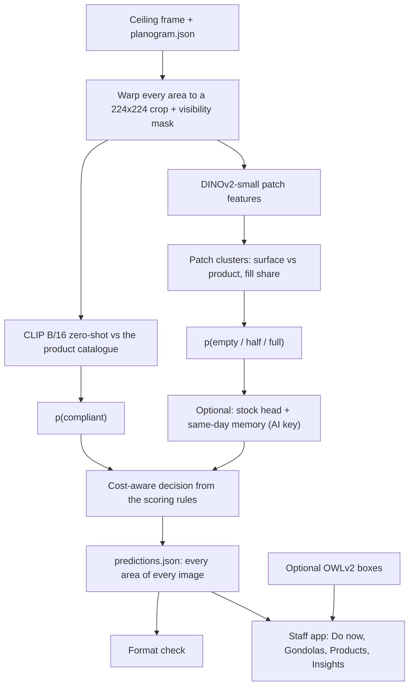

# How Fresh works

The technical companion to the [README](../README.md). Every number links to a tracked file in
[`results/`](../results/README.md) or to the code that produces it.

**Words used here**

| Word | Meaning |
|---|---|
| area | one planogram area (`area_id`, e.g. `6215_2`): a four-sided zone of one camera image |
| AI answer key | `data/labels/teacher_labels_v2.json`: AI-made labels for all 1,962 areas of the 181 frames ([how](LABELLING_GUIDE.md)) |
| label-free | uses no labels at all: the unsupervised fit plus zero-shot CLIP |
| head | a small logistic regression fitted on top of the frozen image features |
| fold | one held-out split: the model is refitted without those cameras or frames, then scored on them |
| per-area memory | labelled crops of the same area from earlier the same day, used as extra evidence |

## 1. The pipeline

1. **Crops.** Each planogram quad (a perspective trapezoid, sometimes partly outside the frame) is warped to a
   224x224 crop, shrunk slightly to avoid neighbours, with a mask of the visible part. Images of another size
   than 1280x720 are resized first. Code: `sensei/data.py`, `sensei/features.py`.
2. **Stock (fill), label-free.** DINOv2-small patch features are clustered. Crates, trays and boxes look the
   same under every product, so clusters spread over many products are "surface" and product-specific clusters
   are "product" (CLIP prompts help name them). Fill is the share of visible patches that are product,
   normalised per area over the day (`sensei/stock.py`).
   **The empty/half/full cut is a fixed rank quantile**: the lowest 7% of fit-time fills are "empty", 7 to 23%
   "half", the rest "full" (`t1 = 0.07`, `t2 = 0.23` in `sensei/stock.py`, softened into probabilities and mixed
   with a level prior of 0.10 / 0.20 / 0.70). These values were chosen while looking at the AI key, whose mix is
   9% empty / 17% half / 73% full. A store or day with a very different share of empty shelves would need them
   re-checked.
3. **Product recognition (compliance), label-free.** CLIP B/16 zero-shot. Portuguese product names are
   translated to English ("MACA GALA KG" becomes "gala apple") and turned into prompts. A crop is scored against
   the whole catalogue, mainly at the base-fruit level (banana vs orange vs apple), with image prototypes as
   supporting evidence. The planogram is often not followed in the real data, so an area's own history is not
   used as its reference. Variety-level confusions (Gala vs Fuji) need strong evidence. Empty, occluded or
   barely visible crops count as compliant (an assumption: see
   [LABELLING_GUIDE.md](LABELLING_GUIDE.md#the-rubric)). Code: `sensei/products.py`, `sensei/compliance.py`.
4. **Calibration with the AI key (optional, used by the submission model).** `sensei/calibrate.py`:
   - **One stock head**: a multinomial logistic regression on fill, CLIP/DINO PCA features, patch-cluster
     histograms and band fills.
   - **Compliance stays zero-shot.** The fitted compliance head scored slightly lower, so it is off
     (`comp_head = False`).
   - **Same-day memory** (needs AI labels of this store from earlier the same day). The cameras are fixed, so
     the model keeps every labelled crop. For a new crop it adds the label mix of the most similar labelled
     crops of the *same area* from *earlier* frames. It is trained with the latest earlier frame sometimes
     dropped, so it does not over-trust labels 2 to 3 hours old. An area with no labelled history (a new
     camera) uses the plain head.
   - **Carried wrong-product flags.** An area whose latest labelled frame showed a wrong product stays flagged
     while its crop still looks the same (DINO cosine of at least 0.6).
   - **Late-day prior (an assumption).** Frames later than a camera's last labelled frame get a lower stock
     prior, because shelves empty out during the day. This assumes the hidden frames are late in the day: the
     brief's only example file name (`1751052241.jpg`, 20:24 Lisbon time) is later than all 181 given frames
     (latest 20:16; the last frame of each camera is between 18:07 and 20:16). If the hidden frames are from
     mid-day, this prior biases stock low.
5. **Cost-aware decision.** The answer with the best *expected* score under the challenge rules: compliance
   threshold 0.5, stock via `scoring.best_stock`, which leans low because "too high" costs -3 and "too low" -2
   (between half and full it picks "full" only when p(full) is above 4/7, about 0.57). Every area is always answered, because a missing
   area costs -2 and -3. Time-neighbour smoothing is off (`smoothing_weight = 0`).
6. **Boxes and counts (staff app only, optional).** OWLv2 (free, local) finds products in the whole frame.
   Boxes with a score of at least 0.28 are drawn; for counting, boxes of at least 0.20 whose centre is inside an
   area are merged (IoU 0.5); boxes the detector labels as hands or baskets, shelf-sized boxes and specks are
   dropped, and in areas the stock model calls empty only boxes of at least 0.35 count. The app shows
   "about N visible units", always labelled as an estimate. Counts were never checked against a hand count.
7. **Staff app.** A static page (`ui/`, built by `sensei/dashboard.py`): no server, no build step, no network,
   so it also opens from a USB stick or a phone. It opens in Portuguese, with an English toggle, light and dark
   mode, from 375 px wide. Views: a prioritised **Do now** list (wrong product and empty first, then low, each
   with the capture time), a **gondola** view with coloured area outlines and a fill sparkline, a per-**product**
   view, and **Insights** (running out soon within 2 hours, sales speed per product from the fill timeline,
   planogram adherence per camera view). **Freshness watch** badges and ethylene-neighbour layout hints come from
   `sensei/freshness.py` and `docs/produce_biology_reference.csv` (sources in
   [`produce_biology_notes.md`](produce_biology_notes.md)); they are estimates from produce biology, not a
   judgement of the picture (`python -m sensei.dashboard ... --no-biology` builds the app without them). All timeline features come from **one day** of
   fill estimates: a prototype of forecasting, not a scored feature.

A `lite` backend (handcrafted colour features only, no torch) exists for tests and quick checks.

## 2. How we measured

Scoring is the challenge's (`scoring.py`): identification +1 / -2, stock +1 / -2 too low / -3 too high, so at
most **2 points per area**. Three held-out tests, all against the AI answer key:

- **Unseen cameras**: leave one camera out, 14 folds, 1,962 areas.
- **Last two labelled frames of every camera**: 304 areas.
- **Last labelled frame of every camera**: 152 areas.

In each fold the calibration heads and memory are refitted without the held-out camera or frames
(`results/heldout.py`, output `results/heldout_v1cal_v3cal_v1mem_v3nomem.json`; the same numbers are in
`results/calibration_cv_real_v3_cal.json` from `python -m sensei calibrate`).

| Points per area (max 2) | Unseen cameras | Last two frames | Last frame | Source |
|---|---:|---:|---:|---|
| Always "compliant" + "full" (baseline) | 0.76 | 0.46 | 0.18 | `calibration_cv_real_v3_cal.json`, `all_full` |
| **Label-free**, core of the submission model | 1.18 | 0.99 | 0.88 | same file, `baseline`; `labelfree_real_v3_cal.json` |
| **Label-free fallback** `models/real_v1` | 1.21 | 1.01 | 0.98 | `labelfree_real_v1.json` |
| Heads, no same-day memory | 1.23 | 1.32 | 1.40 | `calibration_cv_real_v3_cal.json`, `heads_nomem` |
| **Submission** `models/real_v3_cal` (heads + memory) | **1.23** | **1.41** | **1.48** | same file, `heads` |
| Previous submission `real_v1_cal` (heads on its own 1,240-area key, no memory) | 1.18 | 1.28 | 1.36 | `heldout_*.json`, `v1cal|v2` |

On unseen cameras there is no memory, so "heads" and "heads, no memory" are the same model there.

**Error breakdown** (`stock_cases` and `ident_acc` in the same files):

| Test (submission model) | Stock right / too low / too high | Identification right |
|---|---|---:|
| Unseen cameras | 1,607 / 179 / 176 | 95.5% (always "compliant": 94.0%) |
| Last two frames | 258 / 11 / 35 | 99.3% (always "compliant": 97.4%) |
| Last frame | 130 / 9 / 13 | 100% (always "compliant": 97.4%) |

Identification accuracy looks high because most areas are compliant; the real signal is wrong-product recall.
On unseen cameras the model finds 31 of the 117 wrong-product areas, with 2 false alarms in 1,845 correct areas
(`results/final_numbers_real_v3_cal.json`, `camera.heads.wrong_product`). On late frames, part of the found wrong products
come from the carried flags (step 4), not from recognition. Late-frame stock errs high more often than low
despite the low-leaning rule.

**What makes these numbers optimistic or uncertain**

- The key is AI-made, not Sensei's annotations ([LABELLING_GUIDE.md](LABELLING_GUIDE.md)); its stock labels
  agree with a second model family on only 81% of 192 areas.
- The unsupervised part (clusters, PCA, per-area fill normalisation) was fitted on all 181 frames, including the
  held-out frames' pixels (no labels). The hidden frames will not be in the fit.
- Its thresholds and priors, and the head and memory settings, were chosen while looking at this same key and
  these same folds.
- The late-frame rows have only 152 and 304 areas from 14 cameras. No confidence intervals were computed; a
  difference of 0.1 points per area between models on these rows may be noise.
- The late-day prior and the "late frames are the closest rehearsal" reading both rest on the **assumption**
  that the hidden frames are late in the day (step 4).

**Projection to the hidden set (289 areas, max 578), under that assumption:** 1.41 to 1.48 points per area
would be about 410 to 430 points; if the hidden frames span the whole day, the unseen-camera 1.23 gives about
355; label-free, about 255 to 285. The brief's worked example scores 320. These are multiplications, not
measurements, and assume Sensei's annotators label like our AI key.

**Original 756-area key.** The older one-vote key is kept so earlier numbers stay comparable. On it the
submission model scores 1.17 / 1.35 / 1.43 and `real_v1_cal` 1.25 / 1.30 / 1.39; the baseline scores
0.70 / 0.36 / 0.06 (`heldout_v1cal_v3cal_v1mem_v3nomem.json`, keys ending `|756`).

**Not measured / not saved:** larger embeddings (CLIP-L, SigLIP, DINOv2-base) were tried in the heads and gave
no gain in quick tests, but the result table was not saved. The cheaper CLIP B/32 (1.50 CPU-s per image,
`results/benchmark/cost_1t_b32_bf16.json`) was benchmarked for cost only; its accuracy was not tested.

## 3. Cost

Measured with `tools/benchmark_cost.py` on the submission model, 14 frames / 152 areas, no feature cache, one
thread (`SENSEI_THREADS=1`), model loading excluded (about 5 s once per process). Hardware: one core of an
**AMD Ryzen AI 7 350** laptop CPU, which runs bf16 natively. Each run keeps the faster of two passes.

| Setup | CPU-seconds per image | Wall time | Peak RAM | File |
|---|---:|---:|---:|---|
| Submission model, 1 core (median of 3 back-to-back runs) | **3.77** (runs: 3.66, 3.77, 3.84) | 3.6 s | 1.2 GB | `benchmark/cost_1t_real_v3_cal_b2b_run{1,2,3}.json` |
| Same model, run alongside the box benchmark | 4.53 | 4.4 s | 1.8 GB | `benchmark/cost_1t_real_v3_cal_detect.json` |
| `real_v2` (bf16, heads, no memory) | 3.43 | 3.3 s | 1.2 GB | `benchmark/cost_1t_real_v2.json` |
| `real_v1_cal` (fp32) | 5.16 | 5.0 s | 1.3 GB | `benchmark/cost_1t.json` |
| 16 threads (earlier fp32 measurement) | 18.2 | 1.4 s | | `benchmark/cost_16t.json` |
| Optional OWLv2 boxes, 1 core | +15.7 | +15.7 s | | `benchmark/cost_1t_real_v3_cal_detect.json` |

- bf16 cut CPU time by about a third (5.16 to 3.43, `real_v1_cal` to `real_v2`); the per-area memory adds about
  0.3 back (3.43 to 3.77). On a CPU without native bf16 the code runs fp32, so expect about 5.2.
- **Price:** at $0.0446 per vCPU-hour (AWS c7i.large on-demand, $0.0892/h for 2 vCPU, us-east-1), 3.77 CPU-s
  is **$0.000047 per image** (about 5 cents per 1,000; `benchmark/llm_cost_compare.json`). Runs of 3.6 to 4.5
  CPU-s give $0.00004 to $0.00006. This assumes a cloud vCPU (a hyperthread) does the same work per second as
  our laptop core, which we did not test.
- **Per section:** 14 cameras x 12 pictures per hour x 14 opening hours x 30 days = 70,560 images, about $3.3 a
  month, using about 0.18 of one core while the store is open. With boxes on every new frame (+15.7 CPU-s) it
  would be about five times that; the app only needs boxes for the latest frame of each camera.
- **Versus asking a frontier vision LLM about every image** (`tools/llm_cost_compare.py`): with the same two
  pictures our labellers saw (about 4,600 input tokens: the pictures sized with Anthropic's image-token formula
  plus an assumed 1,100-token prompt; about 490 output tokens, our estimate at 45 per area) and Claude API list prices, Claude Sonnet 5.5 costs about $0.014 per image (**about 300 times ours**),
  Opus 5.5 about $0.028 (about 600x), Haiku 5.5 about $0.0007 (about 15x, accuracy untested). These exclude
  thinking tokens (more cost) and batch or caching discounts (less cost; the Batch API's 50% would make Sonnet
  about 150x).
- **Switching on a store:** feature extraction for 181 images is about 181 x 3.8 = 690 CPU-seconds (about 12
  CPU-minutes, derived), plus the fit itself (11.5 s wall-clock with cached features, `model.json`).
- **Skipping unchanged areas: tested, not shipped.** `tools/change_gate.py` (`benchmark/change_gate.json`)
  scores pixel change per area between consecutive frames (about an hour apart). It ranks label-changed pairs
  above unchanged ones with AUC 0.89; skipping 3.8% of areas misses 1 of 281 label changes, skipping 11.9%
  misses 5. Net saving about 4 to 12% (3.77 x (1 - 0.117) = about 3.33 CPU-s; the json itself uses `real_v2`,
  3.43, as reference). It is not wired into `predict`.

## 4. Command line

All commands are `python -m sensei <command>` (`.venv\Scripts\python` on Windows, `.venv/bin/python`
elsewhere):

| Command | Purpose |
|---|---|
| `submit --images <folder\|.zip\|files> [--model models/real_v3_cal] [--out submission] [--no-detect] [--detections <zip\|json>]` | validation day: unpack, predict, check, build the staff app |
| `fit --data <root> --planogram <planogram.json> --model models/m1 [--backend lite\|deep] [--labels ...]` | learn from the unlabelled images (plus heads when `--labels` is given) |
| `predict --model models/m1 --images <dir> --out predictions.json [--details details.json]` | answer every area of every image in `<dir>` |
| `score annotations.json predictions.json` | local challenge score against truth |
| `dashboard --details details.json --data <root> --out dashboard/ [--detections <zip\|json>] [--detect]` | build the static staff app |
| `calibrate --model models/m1 --labels labels.json` | fit heads from labels and report the cross-validated score |
| `label --model models/m1 --data <root> --out labeling/` | optional human labelling page (not used for the shipped key) |
| `run --data <root> --planogram ... --images <dir> --out outputs/` | fit, predict and build the app in one go |
| `synth --out data_synth` | write a synthetic dataset for tests and demos |

`-q` (warnings only) works before or after the sub-command. Tunables live in `sensei/config.py`.

**`submit` in detail.** It unpacks zips (junk such as `__MACOSX` skipped), accepts nested
`<camera>/<ts>.jpg`, `<camera>_<ts>.jpg` or a flat folder of `<ts>.jpg` (the camera is then recognised from the
picture, since the views are static), predicts every area, re-reads the written JSON and checks it (every area of
each camera exactly once, valid values, every image answered, no mass fallbacks), then builds the staff app.
An unreadable image reuses the same area's answer from the nearest readable frame, else its latest label, else
the fit-time median; it never crashes. Exit codes of `python -m sensei submit` (and `SUBMIT.bat`): 0 check
passed, 1 file written but invalid (do not hand it in), 2 no usable input (nothing written). `submit` runs
Hugging Face in offline mode when the weights are cached; other commands may try to reach huggingface.co.

**Rehearsal.** `SUBMIT.bat data\val_sim`, where `data/val_sim/<camera>/<ts>.jpg` is the last frame of each camera
copied from `data/raw/images` (14 images, 152 areas). Those frames were in the fit and in the AI key, so it rehearses the plumbing, not the
score.

**Free Google Colab.** Open `colab/sensei_colab.ipynb`, choose a T4 GPU, and put in `MyDrive/sensei/`:
`junctionx-sensei.zip` (made with `python colab/make_zip.py`), the dataset zip, `planogram.json` and optionally
`validation.zip`. The cells unpack everything, install `requirements.txt`, run `python -m sensei run --labels
data/labels/teacher_labels_v2.json` (the submission recipe) and zip `outputs/` back to Drive. No keys, no paid
tier. `colab/sensei_bigfeatures.ipynb` precomputes OWLv2 boxes for every frame; pass its zip as `--detections`.

**Tests.** `python -m pytest tests -q -m "not slow"` runs the lite-backend suite (184 passed in about 20 s on
2026-10-11); `-m slow` adds the deep-backend
tests (downloads about 600 MB of weights). Tests that need `data/raw` skip on a fresh clone.
`python test_scoring.py` reproduces the brief's worked example (320 of 578).

**Tested with** Python 3.14.7, torch 2.14.1+cpu, transformers 5.19.0, numpy 2.5.3, scikit-learn 1.9.1,
opencv 5.0.0, pillow 12.3.0 (`requirements.txt` sets only lower bounds).
